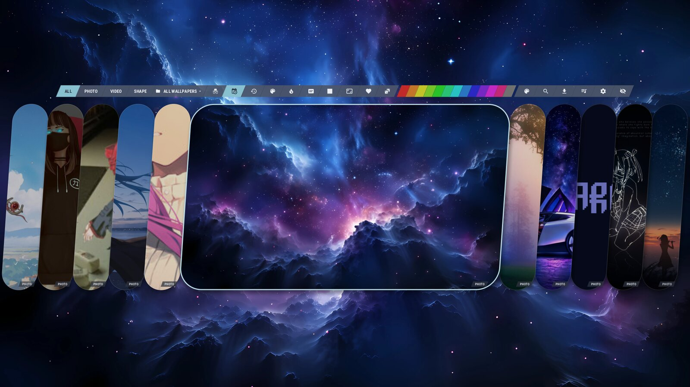
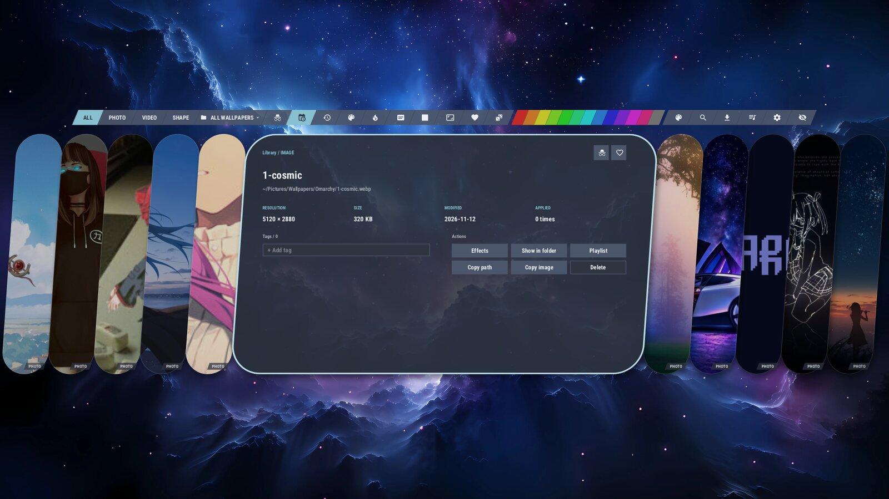
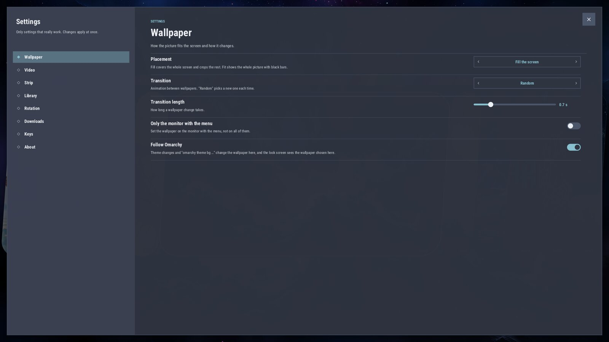
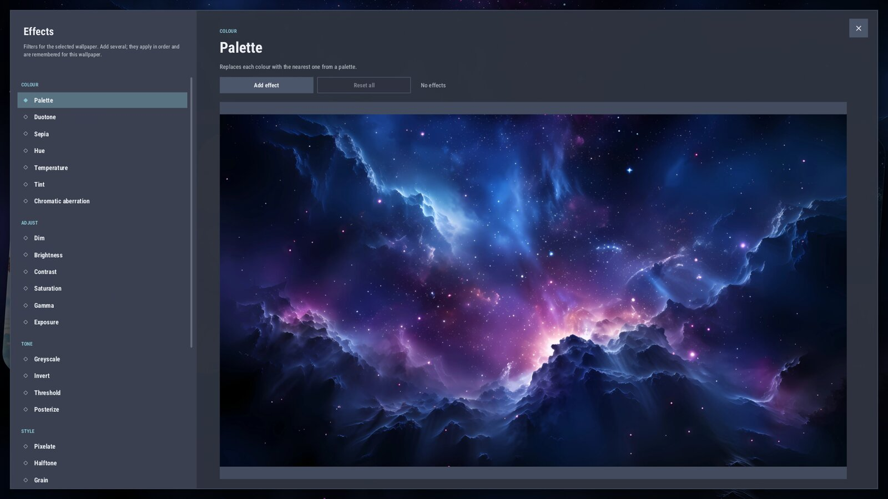
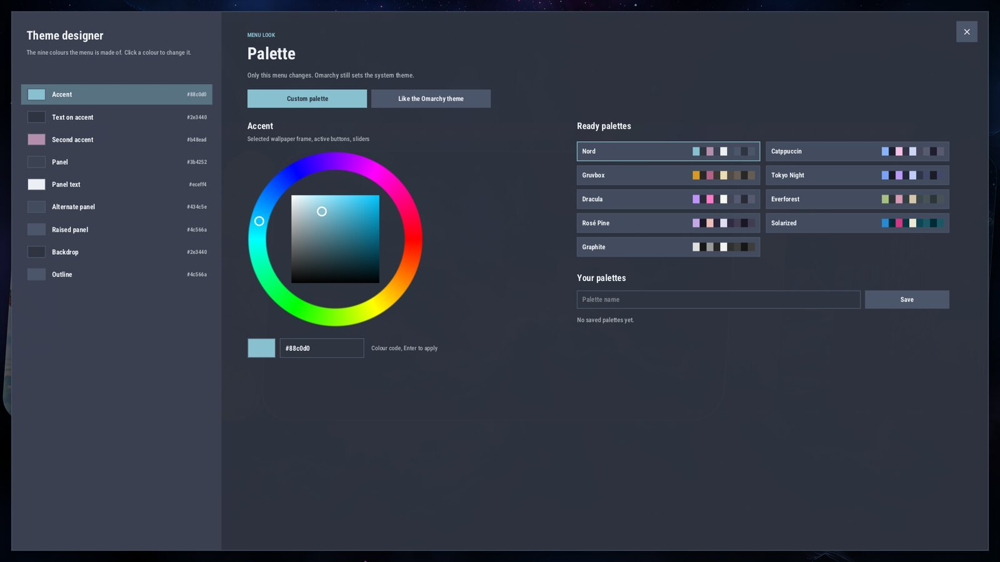

# omawall

**A fast wallpaper engine and wallpaper picker for [Omarchy](https://omarchy.org).**
Photos, videos and Wallpaper Engine workshop wallpapers, a live preview right on your desktop, effects, playlists — and light enough for weak laptops.

[Русская версия ниже ↓](#русский)



## Features

- **The picker** — a strip of slanted slices with a filter bar: type (photo / video), shape, folder, sorting (date, recently used, colour, popularity, colourfulness, calm, resolution), favourites, colour swatches, search and tags.
- **Live desktop preview** — the wallpaper you select shows on the desktop at once. `Enter` keeps it, `Esc` brings the old one back (or turn on *Keep wallpaper on close*).
- **Video wallpapers** — played by mpv with hardware decoding, each video in its own thread, so switching never freezes the menu. Videos pause by themselves while a fullscreen window covers the desktop.
- **Wallpaper Engine workshop** — search the Steam workshop right in the menu, subscribe and set a wallpaper in one click. Video wallpapers play at once; scene wallpapers are recorded once into a looping video.
- **Downloads** from Wallhaven and Bing photo of the day.
- **Effects** — 29 filters (palette, duotone, sepia, blur, pixelate, vignette…), remembered per wallpaper.
- **Playlists and rotation** — change the wallpaper on a timer from the whole library, favourites or a playlist.
- **Theme designer** for the menu itself, or just follow the Omarchy theme colours.
- **18 transitions**, multi-monitor, fractional scaling.
- **Power saver** — turns on by itself on battery and on weak PCs: video is drawn smaller than the screen, heavy transitions become a fade, the menu drops its shadows.
- **English and Russian** — follows the language picked in Omarchy (*Setup → Language*).
- **A proper Omarchy plugin** — install, update, disable and remove it with Omarchy's own commands or menu.

| | |
|---|---|
|  |  |
|  |  |

## Install

You need **Omarchy 4.5 or newer**. Open a terminal (`Super + Enter`) and paste this line, then press `Enter`:

```bash
omarchy plugin add https://github.com/KiraYoshikage7777/omawall --enable
```

Omarchy warns that plugins run unsandboxed code and asks to confirm — choose **Yes**. If it asks where to put the bar button, pick any section (for example `right`).

That's it. After a few seconds:

- the wallpaper is drawn by omawall (Omarchy's own background plugin is switched off so the two do not fight);
- a new button appears on the bar.

You can also install it without a terminal: **Omarchy menu → Setup → Plugins → Add Plugin**, paste the address `https://github.com/KiraYoshikage7777/omawall` and confirm.

## Use

Open the picker with any of these:

- `Super + Ctrl + Space`
- the omawall button on the bar (right click opens settings)
- **Omarchy menu → Style → Background**
- a double click on the desktop wallpaper

| Key | Action |
|---|---|
| `←` `→` | move through wallpapers (`Shift` — by five) |
| `Enter` | set the selected wallpaper |
| `Esc` | close (without `Enter` the old wallpaper comes back) |
| `Space`, `↑` `↓` | flip the card: details, tags, actions |
| `1` `2` `3`, `Tab` | all / photos / videos |
| `F` / `H` / `R` | favourite / hide / random |
| `T` or `/` | search and tags |
| `E` `P` `D` `C` `S` | effects, playlists, downloads, theme designer, settings |
| `V` | hide the menu to look at the wallpaper |

Mouse: a click selects, a click on the selected card sets it, right click flips, the wheel scrolls.

Your wallpapers live in `~/Pictures/Wallpapers` (subfolders work too). More folders can be added in **Settings → Library**. The current Omarchy theme backgrounds are shown as well.

### Wallpaper Engine workshop

1. Install [Steam](https://store.steampowered.com) and own [Wallpaper Engine](https://store.steampowered.com/app/431960/Wallpaper_Engine/) (it does not need to run — only Steam does).
2. Start Steam.
3. In the picker press `D` → **Wallpaper Engine (Steam)**, search, then **Subscribe and set**.

Wallpapers you already subscribed to in Steam show up in the picker by themselves.
To turn **scene** wallpapers into videos, omawall needs a few extra programs, install them once:

```bash
omarchy pkg add sway wf-recorder
omarchy pkg aur add skwd-paper-bin
```

## Settings

- Inside the picker: press `S`.
- From Omarchy: the omawall bar button has *Power saver*, *Keep wallpaper on close* and *Desktop preview* in Omarchy's bar widget settings.
- As a file: `~/.config/omawall/config.toml` (run `omawall reload` after editing).

## Update, disable, remove

```bash
omarchy plugin update kirayoshikage7777.omawall    # update to the latest version
omarchy plugin disable kirayoshikage7777.omawall   # turn off, Omarchy's background comes back
omarchy plugin enable kirayoshikage7777.omawall    # turn on again
omarchy plugin remove kirayoshikage7777.omawall    # remove completely
```

Or in the menu: **Omarchy menu → Setup → Plugins → Enable / Disable / Remove Plugin**.
Disabling restores everything omawall changed: Omarchy's background, the `Super + Ctrl + Space` binding and the menu entry. Your wallpapers, favourites and settings are kept in `~/.config/omawall` and `~/.local/state/omawall`.

## Commands

```bash
omawall toggle                 # open or close the picker
omawall apply <file|name>      # set a wallpaper (-o DP-1 for one monitor)
omawall next | prev | random   # change from the rotation list — handy on a key
omawall pause | resume         # pause or resume video
omawall status                 # what is on screen, memory, decoder
```

## Troubleshooting

- Daemon log: `journalctl --user -u omawall -n 50`
- Plugin log: `~/.local/state/omawall/plugin.log`
- Restart: `systemctl --user restart omawall`
- Video does not play: make sure `mpv` is installed (`omarchy pkg add mpv`).

## Build from source

```bash
omarchy pkg add rust
git clone https://github.com/KiraYoshikage7777/omawall && cd omawall
cargo build --release && cp target/release/omawall bin/omawall
```

## License

MIT, see [LICENSE](LICENSE). Bundled fonts: Roboto Condensed (SIL OFL 1.1, `assets/RobotoCondensed-OFL.txt`), Material Design Icons (Apache 2.0). Wallpapers are not included.

---

<a name="русский"></a>
# omawall — по-русски

**Быстрые обои и меню выбора обоев для [Omarchy](https://omarchy.org).**
Картинки, видео и обои из Мастерской Wallpaper Engine, живой предпросмотр прямо на рабочем столе, эффекты, плейлисты — и при этом легко даже для слабых ноутбуков.

## Что умеет

- **Меню выбора** — лента наклонных срезов и панель фильтров: тип (фото / видео), форма, папка, сортировка (по дате, недавние, по цвету, по популярности, по красочности, спокойные, по разрешению), избранное, цвета, поиск и теги.
- **Предпросмотр на столе** — выбранные обои сразу видны на рабочем столе. `Enter` оставляет их, `Esc` возвращает прежние (или включите «Оставлять обои при закрытии»).
- **Видеообои** — играет mpv с аппаратным декодированием, каждое видео в своём потоке, поэтому переключение не подвешивает меню. Когда стол закрыт полноэкранным окном, видео само встаёт на паузу.
- **Мастерская Wallpaper Engine** — поиск по Мастерской Steam прямо в меню, подписка и установка в один щелчок. Видео играют сразу, сцены один раз записываются в зацикленный ролик.
- **Загрузки** с Wallhaven и фото дня Bing.
- **Эффекты** — 29 фильтров (палитра, два тона, сепия, размытие, пикселизация, виньетка…), запоминаются для каждых обоев.
- **Плейлисты и автосмена** по таймеру: вся библиотека, избранное или плейлист.
- **Дизайнер тем** для самого меню или цвета текущей темы Omarchy.
- **18 переходов**, несколько мониторов, дробный масштаб.
- **Экономный режим** — сам включается от батареи и на слабых ПК: видео рисуется меньше экрана, тяжёлые переходы заменяются растворением, у меню нет теней.
- **Русский и английский** — по языку, выбранному в Omarchy (*Настройка → Язык*).
- **Настоящий плагин Omarchy** — ставится, обновляется, отключается и удаляется штатными командами и меню Omarchy.

## Установка

Нужна **Omarchy 4.5 или новее**. Откройте терминал (`Super + Enter`), вставьте строку и нажмите `Enter`:

```bash
omarchy plugin add https://github.com/KiraYoshikage7777/omawall --enable
```

Omarchy предупредит, что плагины работают без песочницы, и спросит подтверждение — выберите **Да**. Если спросит, куда поставить кнопку на панели, выберите любой раздел (например, `right`).

Всё. Через несколько секунд обои рисует omawall (штатный фон Omarchy отключается, чтобы два движка не мешали друг другу), а на панели появляется кнопка.

Можно и без терминала: **меню Omarchy → Настройка → Плагины → Добавить плагин**, вставьте адрес `https://github.com/KiraYoshikage7777/omawall` и подтвердите.

## Как пользоваться

Меню открывается:

- клавишами `Super + Ctrl + Space`;
- кнопкой omawall на панели (правая кнопка мыши — настройки);
- через **меню Omarchy → Стиль → Фон**;
- двойным щелчком по обоям на рабочем столе.

| Клавиша | Действие |
|---|---|
| `←` `→` | листать обои (`Shift` — по пять) |
| `Enter` | поставить выбранные обои |
| `Esc` | закрыть (без `Enter` вернутся прежние обои) |
| `Пробел`, `↑` `↓` | перевернуть карточку: сведения, теги, действия |
| `1` `2` `3`, `Tab` | все / фото / видео |
| `F` / `H` / `R` | избранное / скрыть / случайные |
| `T` или `/` | поиск и теги |
| `E` `P` `D` `C` `S` | эффекты, плейлисты, загрузки, дизайнер тем, настройки |
| `V` | спрятать меню, чтобы рассмотреть обои |

Мышь: щелчок выбирает, щелчок по выбранной карточке ставит обои, правая кнопка переворачивает карточку, колесо листает.

Обои берутся из `~/Pictures/Wallpapers` (вложенные папки тоже читаются). Другие папки добавляются в **Настройки → Библиотека**. Фоны текущей темы Omarchy тоже видны в ленте.

### Мастерская Wallpaper Engine

1. Установите [Steam](https://store.steampowered.com) и купите [Wallpaper Engine](https://store.steampowered.com/app/431960/Wallpaper_Engine/) (запускать его не нужно — нужен только Steam).
2. Запустите Steam.
3. В меню нажмите `D` → **Wallpaper Engine (Steam)**, найдите обои и нажмите **Подписаться и поставить**.

Обои, на которые вы уже подписаны в Steam, появятся в ленте сами.
Чтобы превращать в видео обои-**сцены**, один раз поставьте дополнительные программы:

```bash
omarchy pkg add sway wf-recorder
omarchy pkg aur add skwd-paper-bin
```

## Настройки

- В самом меню: клавиша `S`.
- Из Omarchy: у кнопки omawall на панели в настройках виджетов Omarchy есть «Экономный режим», «Оставлять обои при закрытии» и «Предпросмотр на столе».
- Файлом: `~/.config/omawall/config.toml` (после правки — `omawall reload`).

## Обновить, отключить, удалить

```bash
omarchy plugin update kirayoshikage7777.omawall    # обновить до последней версии
omarchy plugin disable kirayoshikage7777.omawall   # выключить, вернётся фон Omarchy
omarchy plugin enable kirayoshikage7777.omawall    # включить снова
omarchy plugin remove kirayoshikage7777.omawall    # удалить полностью
```

Или через меню: **меню Omarchy → Настройка → Плагины → Включить / Отключить / Удалить плагин**.
При отключении omawall возвращает всё, что менял: фон Omarchy, клавиши `Super + Ctrl + Space` и пункт меню. Ваши обои, избранное и настройки остаются в `~/.config/omawall` и `~/.local/state/omawall`.

## Команды

```bash
omawall toggle                 # открыть или закрыть меню
omawall apply <файл|имя>       # поставить обои (-o DP-1 — на один монитор)
omawall next | prev | random   # сменить обои из списка автосмены — удобно повесить на клавишу
omawall pause | resume         # пауза и продолжение видео
omawall status                 # что на экране, память, декодер
```

## Если что-то не так

- Журнал демона: `journalctl --user -u omawall -n 50`
- Журнал плагина: `~/.local/state/omawall/plugin.log`
- Перезапуск: `systemctl --user restart omawall`
- Не играет видео: проверьте, что установлен `mpv` (`omarchy pkg add mpv`).

## Лицензия

MIT, см. [LICENSE](LICENSE). Шрифты внутри: Roboto Condensed (SIL OFL 1.1), Material Design Icons (Apache 2.0). Обои в комплект не входят.
